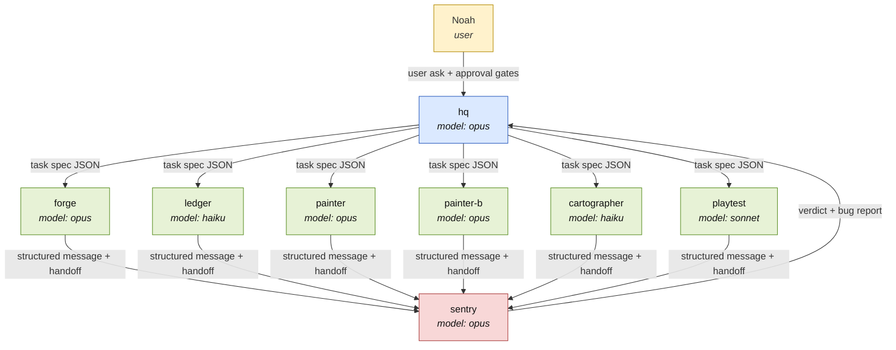

# Ambush! architecture — auto-generated

Generated from `.claude/agents/*.md` + `.claude/state/project.json` + `.claude/tasks/*.json`
by `scripts/gen_architecture.py`.

**Do not edit by hand** — any change here will be clobbered on the next regen.
If a diagram looks wrong, edit the source (agent frontmatter, task JSON, or
`project.json`) and the PostToolUse hook will regenerate this file.

_Last generated:_ `2026-10-23T23:39:17+00:00`

## a) Agent hierarchy

Noah gates the user asks and approvals. HQ owns task splitting + state. Every worker returns a structured message to Sentry (QA tier), which verdicts back to HQ. Each node shows the model actually configured in the agent's frontmatter (sentry checks this against the file at verify time — see sentry's charter).

## b) Shared memory map

```mermaid
flowchart LR
    project_json[(".claude/state/project.json")]:::file
    decisions_md[(".claude/state/decisions.md")]:::file
    messages[(".claude/messages/<id>.json")]:::file
    inbox[(".claude/inbox/<agent>.md")]:::file
    tasks[(".claude/tasks/<id>.json")]:::file
    claude_md[("CLAUDE.md")]:::file
    archive[(".claude/archive/tasks/")]:::file
    noah["Noah<br/><i>user</i>"]:::user
    hq["hq"]:::agent
    forge["forge"]:::agent
    ledger["ledger"]:::agent
    painter["painter"]:::agent
    painter_b["painter-b"]:::agent
    cartographer["cartographer"]:::agent
    sentry["sentry"]:::agent
    playtest["playtest"]:::agent

    hq == W ==> project_json
    hq == W ==> decisions_md
    cartographer == W ==> messages
    forge == W ==> messages
    ledger == W ==> messages
    painter == W ==> messages
    painter_b == W ==> messages
    playtest == W ==> messages
    sentry == W ==> messages
    hq == W ==> inbox
    noah -- W --> inbox
    hq == W ==> tasks
    hq == W ==> claude_md
    hq == W ==> archive
    cartographer -. R .-> project_json
    forge -. R .-> project_json
    hq -. R .-> project_json
    ledger -. R .-> project_json
    painter -. R .-> project_json
    painter_b -. R .-> project_json
    playtest -. R .-> project_json
    sentry -. R .-> project_json
    cartographer -. R .-> decisions_md
    forge -. R .-> decisions_md
    hq -. R .-> decisions_md
    ledger -. R .-> decisions_md
    painter -. R .-> decisions_md
    painter_b -. R .-> decisions_md
    playtest -. R .-> decisions_md
    sentry -. R .-> decisions_md
    hq -. R .-> messages
    hq -. R .-> inbox
    painter -. R .-> inbox
    cartographer -. R .-> tasks
    forge -. R .-> tasks
    hq -. R .-> tasks
    ledger -. R .-> tasks
    painter -. R .-> tasks
    painter_b -. R .-> tasks
    playtest -. R .-> tasks
    sentry -. R .-> tasks
    cartographer -. R .-> claude_md
    forge -. R .-> claude_md
    hq -. R .-> claude_md
    ledger -. R .-> claude_md
    painter -. R .-> claude_md
    painter_b -. R .-> claude_md
    playtest -. R .-> claude_md
    sentry -. R .-> claude_md
    hq -. R .-> archive

    classDef file  fill:#f4f0e6,stroke:#8a7a4a,color:#111
    classDef agent fill:#e7f2d6,stroke:#5a8f23,color:#111
    classDef user  fill:#fff2cc,stroke:#b58b00,color:#333
```

The two-file reading rule says every worker starts a task by reading `project.json` + `decisions.md` and nothing else. The structured handoff lands in `.claude/messages/<id>.json`. The task spec at `.claude/tasks/<id>.json` is HQ-owned. Writes are enforced by sentry's protected-path audit; divergence from the table below is a design bug.

| File | Writers | Readers |
|---|---|---|
| `.claude/state/project.json` | hq | cartographer, forge, hq, ledger, painter, painter-b, playtest, sentry |
| `.claude/state/decisions.md` | hq | cartographer, forge, hq, ledger, painter, painter-b, playtest, sentry |
| `.claude/messages/<id>.json` | cartographer, forge, ledger, painter, painter-b, playtest, sentry | hq |
| `.claude/inbox/<agent>.md` | dashboard, hq, user | hq, painter |
| `.claude/tasks/<id>.json` | hq | cartographer, forge, hq, ledger, painter, painter-b, playtest, sentry |
| `CLAUDE.md` | hq | cartographer, forge, hq, ledger, painter, painter-b, playtest, sentry |
| `.claude/archive/tasks/` | hq | hq |

## c) Open-task dependency graph

Nodes are the live open tasks from `.claude/tasks/`. Blocker nodes at the top are the entries in `project.json.blocked[]`; the `unblocks_tasks` array on each blocker becomes the outgoing edge to every task it blocks. If a task spec itself declares `blocked_by` / `depends_on`, those are drawn as task→task edges.

```mermaid
flowchart LR
    B0("vehicle_render_full_16_directions<br/><i>owner: user</i>"):::blocker
    B1("painter-b_infantry_renders<br/><i>owner: user</i>"):::blocker
    B2("StrategicMap_scene<br/><i>owner: design</i>"):::blocker
    B3("minimap_UI_prereq<br/><i>owner: design</i>"):::blocker
    T187["187<br/>Build StrategicMap.unity scene (placeholder UI + wired butto<br/><i>agent: cartographer</i>"]:::task_cartographer
    T189["189<br/>Static verify Pass HH strategic-map slice<br/><i>agent: sentry</i>"]:::task_sentry
    T206["206<br/>Add MinimapClickToJump handler mapping RawImage clicks to wo<br/><i>agent: forge</i>"]:::task_forge
    T225["225<br/>Redo Abrams sprite sheet<br/><i>agent: painter</i>"]:::task_painter
    T226["226<br/>Redo BMP3 sprite sheet<br/><i>agent: painter</i>"]:::task_painter
    T227["227<br/>Redo BTR3E sprite sheet<br/><i>agent: painter</i>"]:::task_painter
    T228["228<br/>Redo Bradley sprite sheet<br/><i>agent: painter</i>"]:::task_painter
    T229["229<br/>Redo Challenger2 sprite sheet<br/><i>agent: painter</i>"]:::task_painter
    T230["230<br/>Redo EWTruckUkraine sprite sheet<br/><i>agent: painter</i>"]:::task_painter
    T231["231<br/>Redo Gepard sprite sheet<br/><i>agent: painter</i>"]:::task_painter
    T232["232<br/>Redo Koalitsiya sprite sheet<br/><i>agent: painter</i>"]:::task_painter
    T233["233<br/>Redo Leopard2 sprite sheet<br/><i>agent: painter</i>"]:::task_painter
    T234["234<br/>Redo MRAPUkraine sprite sheet<br/><i>agent: painter</i>"]:::task_painter
    T235["235<br/>Redo PzH2000 sprite sheet<br/><i>agent: painter</i>"]:::task_painter
    T236["236<br/>Redo T72 sprite sheet<br/><i>agent: painter</i>"]:::task_painter
    T237["237<br/>Redo TechnicalUkraine sprite sheet<br/><i>agent: painter</i>"]:::task_painter
    T238["238<br/>Redo Tunguska sprite sheet<br/><i>agent: painter</i>"]:::task_painter
    T239["239<br/>Redo EWTruckRussian sprite sheet<br/><i>agent: painter</i>"]:::task_painter
    T240["240<br/>Redo TechnicalRussian sprite sheet<br/><i>agent: painter</i>"]:::task_painter
    T306["306<br/>Re-render BMP3 pick sheet<br/><i>agent: painter</i>"]:::task_painter


    classDef blocker       fill:#f8d7d7,stroke:#a93a3a,color:#111
    classDef task_painter       fill:#f6ddea,stroke:#9f3a76,color:#111
    classDef task_cartographer  fill:#e7f2d6,stroke:#5a8f23,color:#111
    classDef task_forge         fill:#dbe9ff,stroke:#2a5bbd,color:#111
    classDef task_sentry        fill:#f6efcf,stroke:#8a7030,color:#111
    classDef task_ledger        fill:#eaeaea,stroke:#555,color:#111
    classDef task_playtest      fill:#eef3ff,stroke:#3f4fd1,color:#111
    classDef task_hq            fill:#dbe9ff,stroke:#2a5bbd,color:#111
```

