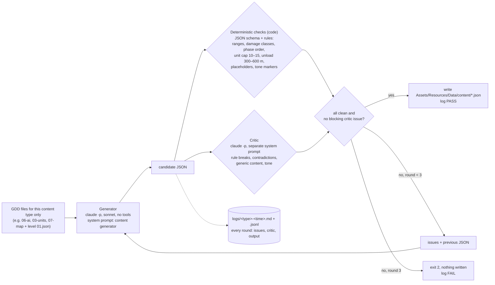

# Assignment 4 — Dynamic Content Pipeline for Ambush!

**Ambush!** is a grounded, drone-era tactics game on today's Ukrainian front line (Unity 6, top-down pixel art). This submission is a content pipeline built inside the game project. It writes game data from the design document (GDD), checks that data with code and with a second AI acting as critic, revises until it passes, and logs every round. The outputs are loaded by the game and proven in the engine.

## Run it

From the root of the game repo:

```
python3 tools/content_pipeline/run.py <assault|unit_cards|battle_text> [--rounds 3] [--model sonnet] [--strict]
python3 tools/content_pipeline/test_checks.py          # deterministic-check self-test, no AI calls
python3 tools/content_pipeline/manifest_to_sim.py      # turns assault manifest #1 into sim scenario S34
```

It needs the `claude` CLI logged in to a Claude subscription; it calls `claude -p` headless, no API key. Exit code 0 means the content passed and was written to `Assets/Resources/Data/content/`. Exit code 2 means it failed loudly after the last round, and nothing was written.

## How the loop works



- **Generator:** reads only the GDD files listed for its content type (`content_types.py`), plus the JSON schema and the task. It returns JSON only.
- **Deterministic checks:** a JSON Schema check (`jsonschema`), then rule checks written in Python.
  - Assault: unit cap 10–15, wave 1 is VehicleAdvance and contains armour, phases in order, every transport carries an infantry squad and unloads at 300–600 m, armour leads by 50–200 m, only real sandbox templates.
  - Unit cards: small arms 180 m, heavy machine gun 220 m, Javelin 300 m; rifles hurt soft targets only; the heavy MG hurts soft and light armour but never heavy; anti-tank weapons hurt heavy armour.
  - Battle text: all five phases present, the routing line says "victory is near", no duplicate lines, no exclamation marks, no placeholder words, only known `{placeholders}`.
- **Critic:** a different system prompt and role. It never wrote the content and judges it against the same GDD excerpts. It returns specific issues as JSON: severity, kind, JSON path, the quoted GDD sentence, and the fix.
- **Revise loop:** the issues and the previous JSON go back to the generator. At most 3 rounds, then it fails loudly. `--strict` also blocks on any critic contradiction, even ones the critic rated minor.

## What I generated

| Output | File | What the game does with it | Proof |
|---|---|---|---|
| (a) Two enemy assault manifests for FlatTest | `outputs/assault_manifests_01.json` | Wave plans for the WaveSpawner: phase, delay, spawn zone, units with template, offset, cargo, `unload_m` and `lead_m` | Sim S34 spawns manifest #1 in the engine (below) |
| (b) Unit data cards: Javelin team and heavy MG squad | `outputs/unit_cards.json` | Stats and the card tooltip for two Ukrainian units | Schema and rule checks, plus the critic |
| (c) In-battle text | `outputs/battle_text.json` | Pre-battle briefing, HQ radio lines per battle phase, event-log lines, routing / victory-near message | The game reads it (new `BattleTextConfig` loader); HUD screenshot below |

The two assaults are tactically different:

- **"Northern Road Push":** *"Main effort moves down the road from the north in two echelons. Armour leads the first echelon, with transports behind it unloading outside small-arms range."* 13 units in 2 waves.
- **"Eastern Flank Assault":** *"Main effort comes from the east, away from the road, with heavy armour leading and transports unloading at long range. A small northern element fixes the defenders' attention."* 14 units in 3 waves.

## Does it sound like the game?

Mostly yes. The GDD asks for "grounded and serious … drones overhead, jamming, netting over trenches", and the lines are short radio and staff talk:

- Bombardment phase: *"Artillery on revealed positions. Stay in cover and ride it out."*
- Mechanised infantry phase: *"Transports behind the armour. They will stop and unload 300 to 600 metres out."*
- Event log: *"{squad} is down. No contact on the net."* and *"Transport stopped at {distance} m. Infantry unloading."*
- Routing: *"The enemy is routing — victory is near."*
- Javelin card: *"Concealed anti-tank team with one Javelin specialist. Holds fire until armour is inside 300 m, then kills tanks and IFVs. Reloads slowly and is helpless once infantry or drones find it."*

Some generic phrasing survived. The Intel line says *"enemy column massing beyond the ridge"*, and FlatTest has no ridge. The critic flagged this as minor, so it did not block. The logs keep every such minor note for a human pass.

## What the critic caught — real examples from the logs

Each example below is quoted from `logs/`.

1. **A rule break the code could not see: Javelin team size** (`logs/unit_cards-20261106-121726.md`, round 1, blocking).
   - Critic: *"The Javelin team has 2 soldiers. Every squad has five soldiers. … GDD: 'The basic unit is a squad of five soldiers.'"*
   - Before: `"soldiers": 2, "hp_per_soldier": 80`
   - After (round 2): `"soldiers": 5, "hp_per_soldier": 100`. The card text gained "with one Javelin specialist".
2. **A self-contradicting radio line** (`logs/battle_text-20261106-121726.md`, round 1, blocking).
   - Before: *"Drone reveals at 150 m. Concealed units stay hidden until they fire."*
   - Critic: *"The second sentence contradicts the first. During Scouting the drone reveals units within 150 m whether or not they have fired."*
   - After: *"Scout drone on the line. Anything inside 150 m gets seen. Keep low, hold fire."*
3. **Mixed perspectives in one event pool** (`logs/battle_text-20261106-122536.md`, round 1, blocking under `--strict`).
   - Before: `["{vehicle} destroyed in {zone}.", "{vehicle} is burning. Crew status unknown.", "Hit confirmed: enemy {vehicle} knocked out.", "{vehicle} destroyed. {count} enemy vehicles remain."]`
   - Critic: *"The four lines assume different sides … [1] reads as a friendly loss … [2] 'enemy'."*
   - After: `["{vehicle} destroyed in {zone}.", "{vehicle} is burning. Crew status unknown.", "{vehicle} knocked out at {zone}.", "{vehicle} destroyed. Hit confirmed."]`
4. **A wrong design reading, caught but not blocked at first.** The first run passed with the briefing *"Two waves: infantry first, armour and mechanized after"*. The critic flagged it, but only as minor. GDD decision 4 says *"Armour leads once transports carry and unload infantry; infantry-first pacing until then"*, and the generator kept reading the "until then" half.
   - **Strict mode failed loudly.** The `--strict` run (`logs/battle_text-20261106-122331.md`) ran 3 rounds without converging and exited without writing anything.
   - **Fix:** I made the task state the order explicitly (transports exist, so armour leads).
   - **Result:** the next strict run passed in round 2. The briefing now reads *"Armour leads, then transports with mechanised infantry. Expect drones and artillery first."*
5. **Invented rules the code would never catch** (minor findings, kept in the logs):
   - *"'Fire on my mark' implies HQ gives fire-control orders. The game has only four orders (Forward/Hold/Back/Retreat)."*
   - *"'Do not fire at the drone unless it is overhead' invents a rule about engaging drones."*

The deterministic checks never fired on real output: the generator always met the schema and the hard numbers. To show they work, `pipeline/test_checks.py` feeds them 10 deliberately broken inputs, and all 10 are caught (`logs/deterministic-selftest.txt`):

```
CAUGHT  assault     transport unloads at 200 m    -> rule: north_road_push/N1_TR1: unload_m 200 outside GDD 06 300–600 m
CAUGHT  assault     unit cap broken (18 units)    -> rule: north_road_push: 21 commandable units; GDD 03 unit cap is 10 to 15 per side
CAUGHT  unit_cards  HMG hurts tanks               -> rule: heavy_mg_squad/M240B machine gun: HMG must damage light armour and not heavy (decision 5)
CAUGHT  battle_text routing line without victory  -> rule: routing_message must carry 'victory is near' (decision 29)
```

So the two layers split the work. Code guarantees the numbers and the structure; the critic catches meaning, which code can't check: a squad size the schema allowed, a line that contradicts itself, a rule the game doesn't have.

## Proof that the outputs load

- **(a) Assault manifest in the engine.** `manifest_to_sim.py` turns manifest #1 into sim scenario `proof/S34_generated_assault.json`: 13 enemy units from the manifest plus 2 player squads. It ran in Unity's sim sandbox, in the Editor, with no full battle. Result `proof/S34_report.json`: **PASS**, 15 of 15 units spawned, transport unload distance **400 m** (inside 300–600), 0 exceptions, 0 error lines. The event log shows the generated armour obeying the vehicle rules: *"N1_IFV keeps 40 m column gap"*, *"N1_IFV halts at 280 m from known AT P2"*. Replay: `proof/S34_replay.gif` (recorded schematic, zoomed game view, rule).
- **(c) Text in the HUD.** The game now loads `battle_text.json`. The intel banner shows the briefing, each battle phase posts its HQ radio line to the event log, and the routing message comes from the data. It's covered by `BattleTextConfigTest` and 28 of 28 related tests. Screenshots from the built Mac app, a 95 s run at 2× (no full battle):
  - `proof/hud_briefing.png`: at 00:08, in the Scouting phase, the event log shows *"Assault on the Line: Company commander, …"* (the briefing) and *"Enemy scout drones over the line. Keep your …"* (the Scouting radio line).
  - `proof/hud_radio.png`: at 02:08, in Armour Advance, it shows *"Armour on the road, closing fast. Save …"*.
  - `proof/hud_app_log_lines.txt` has the full lines the app logged, one radio line per phase in order: Intel, Scouting, Bombardment, VehicleAdvance, MechanizedInfantry.
  - Visible flaw: the HUD event-log panel clips lines longer than about 45 characters. The text is right, but the panel is too narrow for the briefing. That is a UI ticket, not a content problem.

## Cost and limits

- **Cost:** each run is 2–6 `claude -p` calls on sonnet with no tools. The logs record the reported cost: $0.25–0.45 per content type.
- **Limit — minor findings:** the critic's minor findings never block by default, so some generic lines ship. `--strict` closes the contradiction gap, but tone and generic content still need a human read of the logs.
- **Limit — assault in the sandbox:** a wave can't spawn late, so `manifest_to_sim.py` places later waves further back instead (delay × 5 m/s). The full WaveSpawner integration for the FlatTest scene is the next ticket.

## Files

| Path | What |
|---|---|
| `pipeline/run.py` | the loop: generator, checks, critic, revise, log |
| `pipeline/content_types.py` | per type: GDD inputs, task, JSON schema, rule checks, output file |
| `pipeline/prompts/generator.md`, `critic.md` | the two roles |
| `pipeline/test_checks.py` | deterministic-check self-test |
| `pipeline/manifest_to_sim.py` | assault manifest → sim scenario |
| `outputs/` | the three generated JSON files as shipped to the game |
| `logs/` | every run, round by round (`.md` readable, `.jsonl` full data incl. each round's output) |
| `proof/` | S34 scenario, report and replay; HUD screenshots |
