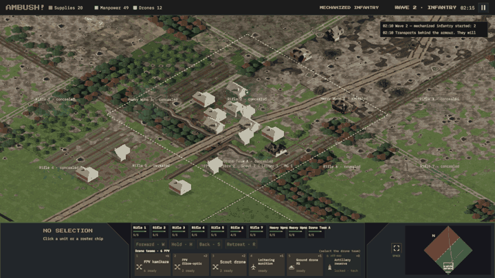
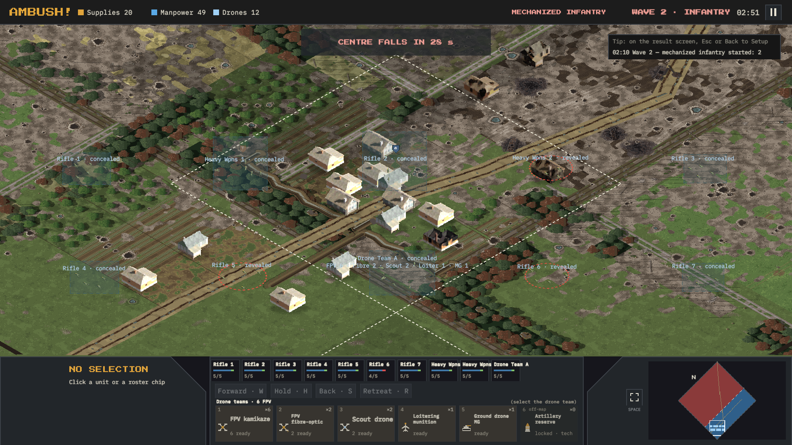

# Assignment 5 — Goal-Oriented Coding Agent for Ambush!

**Ambush!** is a grounded, drone-era tactics game (Unity 6, top-down pixel art). `gap_agent.py` is an agent with one goal: **close the most valuable gap between the game design document and the code.** It read the GDD, scanned the Unity scripts, ranked 41 missing features, wrote the top one into the game, and checked its own work until the requirements were met.

**What it built:** the *town centre hold countdown*. When Russian infantry stands in the town centre with no living Ukrainian soldier inside, the HUD shows "CENTRE FALLS IN n s"; after 60 s in a row the day is lost.



## Run it

```
python3 gap_agent.py --game <game repo>                      # full run: extract, scan, rank, write, re-scan
python3 gap_agent.py --game <game repo> --plan-only          # steps 1-4 only, writes nothing into the game
python3 gap_agent.py --game <game repo> --verify-cmd 'scripts/unity_cli.sh test --platform play --filter {class}'
python3 gap_agent.py --game <game repo> --resume outputs/run-<time>    # continue a run that stopped after a write
```

Python standard library only. It needs the `claude` CLI logged in; it calls `claude -p` headless, no API key. Logs go to `outputs/run-<time>/`.

## How the agent works

| Step | What happens | How |
|---|---|---|
| 1. Extract | Reads 16 files of `docs/gdd/*.md`, lists up to 10 code features per file, each with a verbatim GDD quote, expected code terms, loop impact 1–5, size, risk and dependencies. Three files are skipped (index, team process, story bible). | `claude -p`, sonnet, no tools, cached per file |
| 2. Scan | Indexes every C# file under `Assets/Scripts` (classes, public methods). First a plain search for each feature's code terms, then a strict judge decides `exists`, `partial` or `missing` and which dependencies are present. | regex, then `claude -p` judge |
| 3. Gaps | The `missing` features. | code |
| 4. Rank | `priority_score()` for every gap, printed as a table. | code, no AI |
| 5. Write | Writes acceptance requirements (each with a regex a script can check), then writes the feature into the game. Any change outside `Assets/Scripts` and `Assets/Tests` is undone and reported. | `claude -p`, opus, tools Read/Grep/Glob/Edit/Write |
| 6. Iterate | Re-scans: every requirement pattern must match, the judge must now say `exists`, and the verify command (Unity compile and test) must pass. If not, the unmet items and the compiler or test output go back to the writer. Stops when all are met or after `--max-tries` (3). | code + Unity |

## Result on the real game

- **157 features** extracted from the GDD: **51 exist, 65 partial, 41 missing**.
- The judge is a language model, so counts move a little between runs (an earlier plan-only run gave 47 / 68 / 42). The top three ranks were the same in both.

### Why `priority_score()` picked it

```
score = 100 × (0.40 × impact + 0.25 × deps met + 0.20 × small + 0.15 × low risk)
```

- **impact**: how much the playable loop (set up, defend, enemy attacks, win or lose) needs it, 1–5 from the design text.
- **deps met**: the share of the systems it depends on that the scan found in the code.
- **small**: S = 1, M = 0.5, L = 0.1.
- **low risk**: low = 1, medium = 0.5, high = 0.1 (does it change combat, movement or AI results?).

Top 10 of 41 (all rows: [`proof/logs/scores_all_gaps.md`](proof/logs/scores_all_gaps.md)):

| # | id | feature | score | impact (40) | deps met (25) | small (20) | low risk (15) | size | risk |
|---|---|---|---|---|---|---|---|---|---|
| 1 | 02-02 | Town centre hold countdown | **79.5** | 32.0 | 12.5 | 20.0 | 15.0 | S | low |
| 2 | 18-01 | Cover arc display | **76.0** | 16.0 | 25.0 | 20.0 | 15.0 | S | low |
| 3 | 16-07 | Armour and penetration data loading | **74.0** | 24.0 | 25.0 | 10.0 | 15.0 | M | low |
| 4 | 09-03 | Centre-held countdown | **66.3** | 32.0 | 16.8 | 10.0 | 7.5 | M | medium |
| 5 | 07-02 | Town centre objective | **65.8** | 40.0 | 8.2 | 10.0 | 7.5 | M | medium |
| 6 | 16-05 | Infantry body armour factor | **62.5** | 16.0 | 25.0 | 20.0 | 1.5 | S | high |
| 7 | 01-01 | Centre-held loss countdown | **62.0** | 32.0 | 12.5 | 10.0 | 7.5 | M | medium |
| 8 | 10-04 | Daily wave from days.json | **62.0** | 32.0 | 12.5 | 10.0 | 7.5 | M | medium |
| 9 | 13-01 | Day loop with carry-over | **60.2** | 40.0 | 16.8 | 2.0 | 1.5 | L | high |
| 10 | 13-03 | Night screen and setup | **60.2** | 32.0 | 18.8 | 2.0 | 7.5 | L | medium |

The countdown won because it is the only gap that is high-impact (it is one of the ways a day is lost), small and low-risk at once. It lost points on dependencies: the scan found the HUD but no "day loss conditions" system, so only half its dependencies were met. The bigger loop features (day loop, town centre objective) score higher on impact but are medium or large and risky.

GDD line it comes from (`02-core-loop.md`): *"Russian infantry is inside the town centre, and no living Ukrainian soldier is inside it, for **60 s** in a row (HUD countdown)"*.

### What the agent wrote

Branch `a5/gap-agent` of the game repo, commit `216b6c7c3`, exactly as generated ([`proof/generated_feature.patch`](proof/generated_feature.patch), 576 lines):

| File | What |
|---|---|
| `Scripts/Game/TownCentreZone.cs` (new, 136 lines) | Who is inside the zone each frame, the 60 s timer, `OnCentreHeld` raised once |
| `Scripts/UI/CountdownHud.cs` (new, 95 lines) | The "CENTRE FALLS IN n s" panel under the top bar, hidden when the timer resets |
| `Scripts/Game/BattleEndChecker.TownCentre.cs` (new, 58 lines) | Ends the battle as an enemy win when the centre is held |
| `Tests/PlayMode/TownCentreHoldTest.cs` (new) | Two play-mode tests |
| `BattleEndChecker.cs`, `HudFrame.cs`, `FeatureFlags.cs` | Three hook-up edits: `partial`, one call each, one flag `TownCentreHold` |

### The iteration loop, as it ran

| Try | Write | Re-scan | Unity verify | Result |
|---|---|---|---|---|
| 1 | 7 files | 6 of 6 requirements met; judge: `exists` | **FAIL**: the test filter `CountdownHud` matched 0 tests (the test was named `TownCentreHoldTest`) | not accepted; the Unity output went back to the writer |
| 2 | added a second test, `CountdownHud_ShowsRemainingSeconds_…` | 6 of 6 met; judge: `exists` | **PASS** | accepted, loop stopped |

Logs: [`proof/logs/`](proof/logs/). Agent cost: $1.54 for the plan-only run (extract, scan, rank) and $0.80 for the resumed run (re-scans and the second write). The cost of the first write was not logged, because that run crashed before its report.

## Proof: the feature in the built game

- **Unity play-mode tests:** `TownCentreHoldTest`, 2 of 2 pass.
- **Mac build:** `Builds/Mac/Ambush.app` built from the branch, no compile errors.
- **Built game run:** [`proof/countdown_built_game.png`](proof/countdown_built_game.png) shows "CENTRE FALLS IN 28 s" in the standalone app. [`proof/day_lost_built_game.png`](proof/day_lost_built_game.png) shows the battle ended with "DAY LOST — the enemy holds the town centre." in the event log. The player log lines are in [`proof/built_game_log_lines.txt`](proof/built_game_log_lines.txt).



## Manual changes

Everything a person (or the session driving the agent) had to change is listed here.

**To the agent itself**

1. **Crash after the first write.** For a single feature the judge replied with one JSON object instead of a list, and the re-scan crashed. I made the parser accept both and added `--resume`, then continued the same run at the re-scan. The first write was not repeated. Console log of the crash: `proof/logs/run1_console_crashed_after_write.log`.
2. **Change log.** A second edit to a file that was already new was not listed under "wrote". Fixed after the run (content hash instead of git status).

**To the generated game code** ([`proof/manual_changes.patch`](proof/manual_changes.patch), 39 lines, commit `d2893f7a7`)

3. **Zone position for the proof run.** No level names a town centre yet, so the agent put the zone at the middle of the map. In three built-game runs the countdown never appeared: the defenders hold the middle, and if every squad withdraws the battle ends first. I added a launch argument, `-towncentre x,z,half`, that places the zone, and one line in the game's run script to pass it. The screenshots use a zone on the enemy's approach road. The rule, timer, HUD and tests are untouched.

No manual fix was needed to make the code compile or the tests pass.

**Open issues, not fixed**

- The end banner still reads "DEFEAT — enemy broke through" for a centre loss; only the event log says "DAY LOST". The banner needs its own text.
- The requirements writer widened the feature from "HUD countdown" to the full loss rule (the battle really ends). That is what the GDD says, but it is more than the feature's "S, low risk" label, and it is why the feature stays on its branch behind a flag until the level data names a real town centre.
- The first Unity verify ran only the tests matching the new class name. The full play-mode suite and the full battle gate were not run before this submission.
- Rank 4 and rank 7 are the same feature read from other GDD files; the agent does not merge duplicates.

## Files

```
gap_agent.py     the agent (one file, standard library)
README.md
proof/           screenshots, GIF, run logs, the generated patch, the manual patch
```

The game itself is in a separate, private repo. Nothing from the Asset Store, no keys and no `.env` are in this folder.
